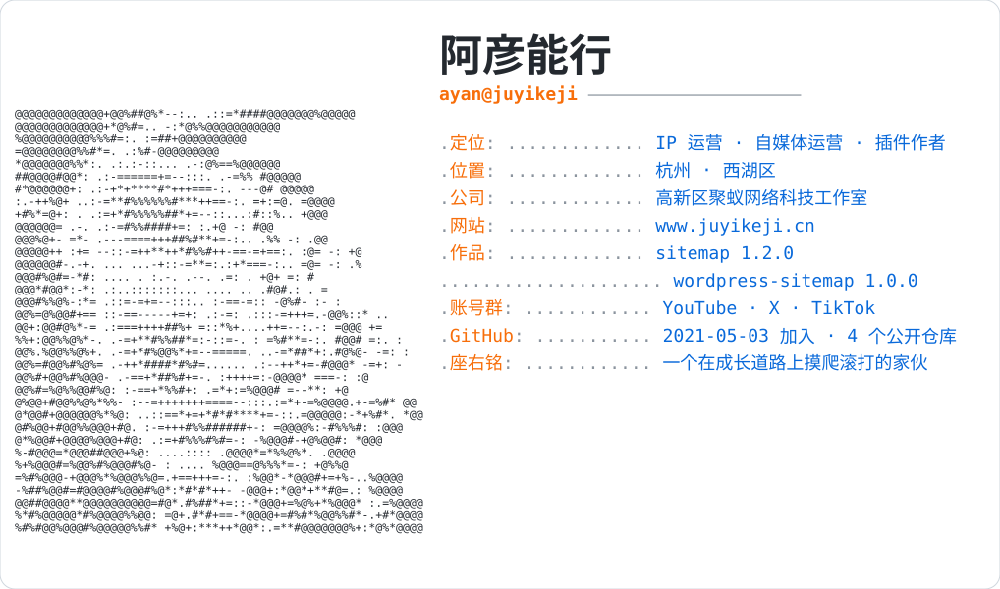

<a href="https://www.juyikeji.cn">
  <picture>
    <source media="(prefers-color-scheme: dark)" srcset="https://raw.githubusercontent.com/JUYIKEJI/JUYIKEJI/main/banner_dark.svg">
    
  </picture>
</a>

<p align="left"><a href="https://www.juyikeji.cn"></a><a href="https://github.com/JUYIKEJI"></a><a href="https://github.com/JUYIKEJI/wordpress-sitemap"></a></p>

<picture>
  <source media="(prefers-color-scheme: dark)" srcset="https://raw.githubusercontent.com/JUYIKEJI/JUYIKEJI/output/pacman-contribution-graph-dark.svg">
  <source media="(prefers-color-scheme: light)" srcset="https://raw.githubusercontent.com/JUYIKEJI/JUYIKEJI/output/pacman-contribution-graph.svg">
  
</picture>

```text
ayan@juyikeji
──────────────────────────────
名字    阿彦能行 / 阿彦
位置    杭州 · 西湖区
工作    光年 · IP 运营
公司    高新区聚蚁网络科技工作室
网站    www.juyikeji.cn
GitHub  2021-05-03 加入
```

## 在做的事

- **sitemap** — Typecho 网站地图插件，1.2.0 版：首页、页面、文章按权重和频率生成 `sitemap.xml`
- **wordpress-sitemap** — WordPress 网站地图插件，1.0.0 版：只收已发布内容，打开 `sitemap.xml` 就能看到整站地图
- **chatgpt-VIP** — 2024 年 2 月留存的一份旧程序备份，之后没有再更新

---

自媒体账号群运营中：视频和标题由我来，文案和发布交给 Tavis。
