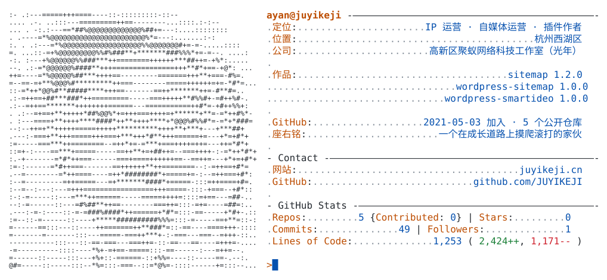

<a href="https://www.juyikeji.cn/">
  <picture>
    <source media="(prefers-color-scheme: dark)" srcset="https://raw.githubusercontent.com/JUYIKEJI/JUYIKEJI/main/dark_mode.svg">
    
  </picture>
</a>

<a href="https://www.juyikeji.cn/"><picture><source media="(prefers-color-scheme: dark)" srcset="https://raw.githubusercontent.com/JUYIKEJI/JUYIKEJI/main/link_website_dark.svg"></picture></a><a href="https://github.com/JUYIKEJI"><picture><source media="(prefers-color-scheme: dark)" srcset="https://raw.githubusercontent.com/JUYIKEJI/JUYIKEJI/main/link_github_dark.svg"></picture></a><a href="https://github.com/JUYIKEJI/wordpress-sitemap"><picture><source media="(prefers-color-scheme: dark)" srcset="https://raw.githubusercontent.com/JUYIKEJI/JUYIKEJI/main/link_plugins_dark.svg"></picture></a>

<picture>
  <source media="(prefers-color-scheme: dark)" srcset="https://raw.githubusercontent.com/JUYIKEJI/JUYIKEJI/main/pacman_dark.svg">
  
</picture>
